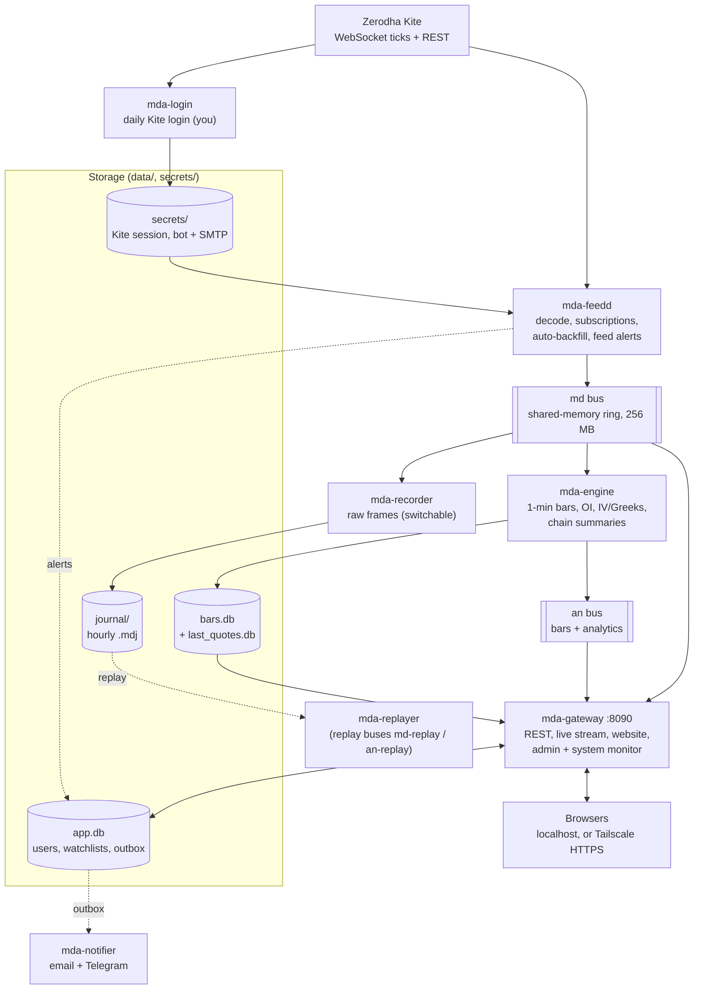

# Architecture overview

> Status: **Current** (2026-10-23): the processes as they run today. The long-term map is
> [ett-platform.md](ett-platform.md); decisions are in the ADRs.

## Process view

`tools/stack.sh` starts, stops and checks all of them (pid files in `data/run/`, logs in
`data/logs/`) and keeps the Mac awake while mda-feedd runs.

## Processes

| Process | Owns | Separate process because |
|---|---|---|
| `mda-login` | Daily Kite login (you run it); writes the session to `secrets/` | Once a day, interactive, off the data path |
| `mda-feedd` | Kite WebSocket, binary decoding, subscriptions (static + watchlists + option windows), auto-backfill (ADR-0025), feed-down / session alerts; the only writer of `md` | The hot path: nothing may slow it |
| `mda-recorder` | Appends every raw frame to the tick journal (ADR-0026); `recorder.enabled` switches it | Disk stalls must never reach the feed |
| `mda-engine` | 1-minute bars, OI buildup, IV/Greeks, chain summaries; writes `bars.db` and `last_quotes.db` (ADR-0024); the only writer of `an`; keeps time by the ticks (event clock) | Heavy compute; restarts without touching the feed |
| `mda-gateway` | REST, the live WebSocket stream, the built website (ADR-0027), auth and admin, the system monitor | A slow browser must never back-pressure the engine |
| `mda-notifier` | Delivers the notification outbox by email and Telegram; the Telegram bot | Network calls to outside services stay off the data path |
| `mda-replayer` | Replays a recorded day onto separate buses (`md-replay`, `an-replay`) at 1× to max | Tests, after-hours work, backtesting later |
| `npm run dev` | The website with hot reload on :5173 (development only, never exposed) | Development convenience |

## Data flows

**Live:** Kite → `mda-feedd` → bus → `mda-recorder` (journal) and `mda-engine` (state)
→ `mda-gateway` (cache) → browser.

**Test mode:** `mda-replayer` reads the tick journal and replaces `mda-feedd`.
Downstream processes cannot tell the difference — this is what makes after-hours
development and high-speed load testing possible.

## Memory vs storage

**Rule: memory serves the present; storage serves history.**

| Data | Served from | Written by |
|---|---|---|
| Latest price, volume, OI, depth | Gateway cache (RAM) | Engine |
| Option chains | Gateway cache (RAM) | Engine |
| Forming bar (current minute) | Gateway cache (RAM) | Engine |
| Today's closed bars | Gateway cache (RAM) | Engine (also persisted to the bar store) |
| Previous days' bars | Bar store (read once per chart load) | Engine at bar close; corrected by backfill |
| Users, watchlists, settings | App DB (cached in RAM) | Gateway |
| Every tick | Tick journal (for replay and recovery) | Recorder |

Sizing: ~6,000 instruments × 375 one-minute bars × ~48 B ≈ **110 MB** for a full
trading day. Higher timeframes are derived from 1-minute bars.

Opening a chart: history from the bar store + today's bars from the gateway cache,
then live updates pushed over WebSocket.

## Engine → gateway replication

The gateway keeps a replica of the engine's state using **snapshot + incremental
updates with sequence numbers** — the same pattern exchanges use for market-data
recovery:

1. On (re)start, the gateway requests a full snapshot tagged with sequence number *N*.
2. It then applies updates *N+1, N+2, …* from the stream.
3. A sequence gap triggers a fresh snapshot.

## Storage

| Store | Contents | Candidate technology (open) |
|---|---|---|
| Tick journal | Raw packets + normalized events, one file set per trading day | Custom append-only binary format |
| Bar store | Price/volume/OI candles, all instruments | DuckDB, Parquet, or hybrid |
| App DB | Users, watchlists, settings, instrument master | SQLite |
| Secrets | API key/secret, daily session token | Git-ignored files, `0600` ([ADR-0005](../adr/0005-secrets-handling.md)) |

## Failure and recovery

See [recovery and gap filling](../design/recovery-and-gap-filling.md).

## Open decisions

- ~~IPC mechanism for the bus~~ — decided: shared-memory broadcast ring ([ADR-0007](../adr/0007-shared-memory-broadcast-bus.md), [design](../design/market-data-bus.md)); benchmarked against Unix sockets as part of the build.
- ~~Build order~~ — decided: multi-process from the start ([ADR-0006](../adr/0006-multi-process-from-the-start.md)).
- Bar store technology.
- Gateway library (Beast vs uWebSockets vs Drogon) and tick encoding (JSON vs binary).
